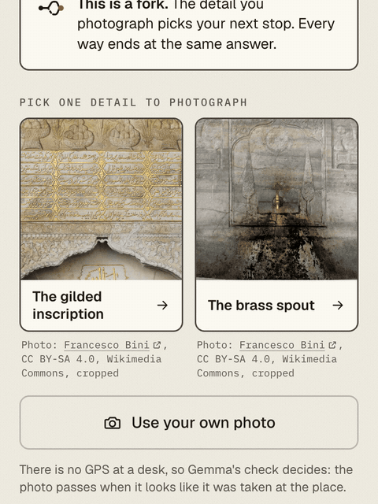

# Forking Paths

A voice-first walking mystery for your phone, written by an open-weight model.

Gemma writes a short case from facts about the streets near you, and every fact comes with its link.
A narrator reads each clue, so you can lock your phone and walk.
At each fork, the detail you photograph picks your next stop.
Every route ends at the same answer.



**Demo video:** [YouTube](https://www.youtube.com/watch?v=i4n_3ieU8x0) · **Write-up:** [DEV](https://dev.to/asiboy6789/your-photo-picks-the-next-street-a-walking-mystery-on-open-weight-gemma-33od)

## Try it from your desk

You need Node 22, pnpm and Docker.

```bash
cd apps/web
cp .env.example .env.local     # add GOOGLE_GENERATIVE_AI_API_KEY for live Gemma
pnpm install
docker run -d --name forking-paths-mongo -p 127.0.0.1:27017:27017 mongo:8
pnpm db:check                  # connects and creates the indexes
pnpm dev                       # then open http://localhost:3000/demo
```

The desk demo plays a saved case in Karaköy, Istanbul, with sample photos, so it needs no GPS.
It also plays with no API keys: its voice clips are in the repo, and each sample photo has a stored result.

## How it works

| Part | What it does |
|---|---|
| Next.js 16 app (`apps/web`) | The phone pages and the API. |
| Mastra workflows | `generate-quest` researches, writes, validates and saves a case. `play-quest` pauses the walk at each stop until a photo arrives. |
| Gemma 4 | `gemma-4-31b-it` writes the case. `gemma-4-26b-a4b-it` reads photos and writes the bridge lines. `gemma4:e4b` can do the photo check on your own machine. |
| Validator | Rejects unknown fact IDs, numbers that are not in the cited facts, compass words, unsafe lines and broken routes. |
| SerpApi and Wikipedia | Places and facts near a point rounded to about 100 m, with at most 6 SerpApi searches per case. |
| ElevenLabs | The narrator's voice, cached, under a daily cap. |
| MongoDB | Cases, walks, caches and the daily counters. |
| Sentry | Traces, with photos kept out. |

Every language-model call goes to Gemma. On Google AI Studio, the app accepts only Gemma model IDs.
The full developer guide is [`apps/web/README.md`](apps/web/README.md).

## Gemma on your own machine

```bash
ollama pull gemma4:e4b
```

```bash
# apps/web/.env.local
GEMMA_READER_PROVIDER=ollama       # the photo check only; GEMMA_PROVIDER=ollama moves every role
OLLAMA_BASE_URL=http://localhost:11434/v1
OLLAMA_MODEL=gemma4:e4b
```

The photo check then runs on your machine.
To play on a phone, or to reach Ollama through a tunnel, see
[Gemma on your own machine](apps/web/README.md#gemma-on-your-own-machine) in the developer guide.

## Deploy

[](https://render.com/deploy?repo=https://github.com/asi-mir/forking-paths)

[`render.yaml`](render.yaml) creates one web service.
Set `MONGODB_URI` to a MongoDB Atlas connection string, and fill in the keys that Render asks for.
Then check that `/api/health` returns 200, and open `/demo`.
The variables and the daily caps are in [Deploy to Render](apps/web/README.md#deploy-to-render).

## Privacy and safety

- The phone resizes each photo and encodes it again, so no EXIF data is sent. The server does not store photos.
- With Google AI Studio, the photo goes to Google. With Ollama, it goes to your own machine.
- Research gets only a point rounded to about 100 m.
- Clues never send a player onto a road or into private property, and never ask for photos of people.
  The validator checks every line.
- The game is for daylight only.

## Evals

The eval scripts are in `apps/web/scripts`. The [Evals](apps/web/README.md#evals) section of the developer guide explains each one.
Results from runs on 2026-10-10:

| What it measures | Result |
|---|---|
| Right cue for 28 photos of street details | 26 of 28 with `gemma-4-26b-a4b-it`, 22 of 28 with `gemma4:e4b` |
| The two desk-demo fork photos lead to two different stops | 10 of 10 runs |
| Sampled facts that hold against their source | 30 of 30 |
| First drafts that pass the validator, current prompt | 8 of 9 |

## Credits

- **Model:** Gemma 4 by Google (Apache 2.0), on Google AI Studio and [Ollama](https://ollama.com) (MIT).
- **Code:** Next.js, React, zod, Tailwind CSS and the Sentry, ElevenLabs and SerpApi SDKs (MIT).
  Mastra, the AI SDK and the MongoDB driver (Apache 2.0).
- **Facts:** Wikipedia (CC BY-SA 4.0) and Google results through [SerpApi](https://serpapi.com).
- **Voice and sound:** made with [ElevenLabs](https://elevenlabs.io), with the premade voice "George".
- **Photos:** Wikimedia Commons, CC BY-SA 4.0: Francesco Bini, Basak, Ali Osman Dilekoğlu and Another Believer
  ([file pages](apps/web/public/demo/credits.json)). The eval photos are credited in
  [`manifest.json`](apps/web/eval/photos/manifest.json).
- **Fonts:** Geist, Fraunces and IBM Plex Mono (SIL Open Font License).

The full list is in [Credits (full)](apps/web/README.md#credits-full).

## Contributing

Read [`AGENTS.md`](AGENTS.md) first. Run `pnpm check` in `apps/web` before every pull request.

## Commits after the deadline

This project is an entry in the DEV Hacktoberfest Open-Source AI Challenge, Week 1: "Touch Grass".
The challenge closes on 2026-10-11 23:59 PDT.
Any commit after that time is listed here.

- (none yet)

## License

[MIT](LICENSE)
